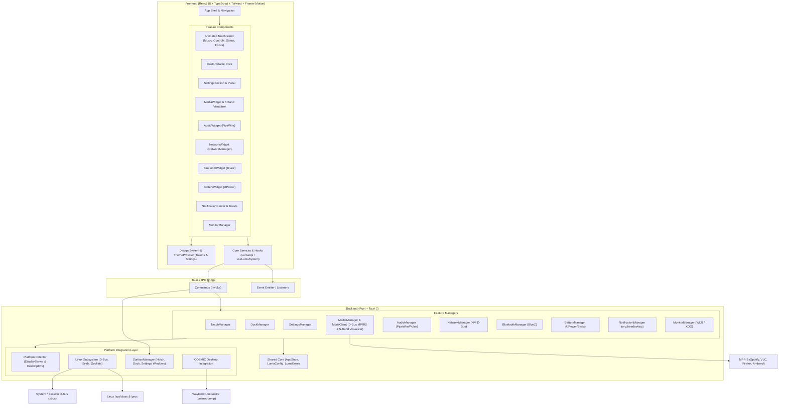

# Luma Application Architecture

This document defines the software architecture, design principles, module hierarchy, window management, and IPC contracts of **Luma**.

---

## 1. Architectural Principles

1. **Separation of Concerns**: Strict decoupling between the shared application core, platform-specific subsystem integrations, desktop environment adapters, and visual feature widgets.
2. **Type Safety Across FFI Boundaries**: Direct 1-to-1 correspondence between Rust domain structs (using `serde`) and TypeScript interfaces.
3. **Graceful Subsystem Degradation**: Subsystems (e.g., Bluetooth, UPower, PipeWire, MPRIS) operate independently. If a hardware controller or D-Bus daemon is absent or restricted, Luma degrades gracefully without crashing.
4. **Minimal Runtime Overhead**: Efficient event-driven updates, low polling frequencies, and hardware-accelerated WebKit rendering powered by Tauri 2 and Rust.

---

## 2. System Architecture Diagram

---

## 3. Desktop Surface Integration Architecture (Phase 3)

Luma manages 3 independent desktop surfaces:
1. **Notch Window (`notch`)**:
   - Anchored to the top screen edge of the primary or targeted monitor.
   - Transparent, borderless, always-on-top, and excluded from the taskbar.
   - Synchronously resized via `resize_notch_surface` during Framer Motion expansion/collapse transitions.
2. **Dock Window (`dock`)**:
   - Anchored to the bottom screen edge (or left/right side).
   - Transparent, borderless, always-on-top, with interactive icon magnification and running app indicators.
3. **Settings Window (`settings`)**:
   - Standard decorated desktop window centered on screen.
   - Hosts the complete application configuration and customization suite.

### Display Scaling & Multi-Monitor Targeting
- Probes monitor bounds (`Monitor::size()`) and scaling factor (`Monitor::scale_factor()`).
- Calculates physical and logical dimensions dynamically to prevent positioning drift across high-DPI displays.

---

## 4. Animated Notch Architecture (Phase 4)

The Luma Notch operates as an interactive floating island driven by Framer Motion spring physics:
- **Collapsed Mode**: Compact pill (220px × 38px) displaying status indicator, active track/title, battery percentage, and time.
- **Expanded Mode**: Expands smoothly (460px × 340px) with 4 specialized sub-modes:
  - **Music**: Album art, track metadata, playback transport controls, and live 5-band frequency visualizer.
  - **Command Center**: Wi-Fi toggle, Bluetooth toggle, PipeWire volume slider, and display brightness slider.
  - **Status**: Battery charge telemetry with time-remaining estimates and Pop!_OS weather widget.
  - **Focus & Calendar**: Upcoming agenda meetings and interactive Pomodoro focus session timer.

---

## 5. Linux Media Integration & Visualizer (Phase 5)

### Real MPRIS over D-Bus
- Communicates directly over the D-Bus Session Bus using `zbus`.
- Queries `org.freedesktop.DBus` `ListNames` to discover running media applications matching `org.mpris.MediaPlayer2.*` (Spotify, VLC, Firefox, Chrome, Amberol, Rhythmbox, etc.).
- Reads `PlaybackStatus` and extracts `Metadata` dictionary (`xesam:title`, `xesam:artist`, `xesam:album`, `mpris:artUrl`, `mpris:length`).
- Issues transport commands: `PlayPause`, `Next`, `Previous`.

### 5-Band Frequency Visualizer
- Bands:
  - **Sub-Bass**: 60 Hz
  - **Bass**: 250 Hz
  - **Midrange**: 1 kHz
  - **Upper-Mid**: 4 kHz
  - **Treble**: 16 kHz
- Probes PipeWire runtime socket (`/run/user/<uid>/pipewire-0`).
- Provides real-time frequency energy metrics, explicitly identifying live stream vs harmonic DSP mode via `is_live_dsp: bool`.

---

## 6. Linux System Controls (Phase 6)

Luma directly interfaces with modern Linux system services without requiring root privileges:
- **Audio (PipeWire & WirePlumber)**: Reads volume and mute states via `wpctl` / `pactl` JSON, adjusts output levels, and manages default sink/source routing.
- **Network (NetworkManager)**: Queries Wi-Fi radio status, connection state, SSID, signal strength %, IP addresses, and allows toggling Wi-Fi and scanning nearby access points via `nmcli`.
- **Bluetooth (BlueZ)**: Queries adapter status, power state, and lists paired peripherals with battery telemetry via `bluetoothctl`.
- **Battery (UPower & Sysfs)**: Reads live battery charge, state (`Charging`, `Discharging`, `Full`), and calculates remaining discharge time from energy and power rates.
- **Backlight (systemd-logind D-Bus & Sysfs)**: Reads `/sys/class/backlight/*` and adjusts screen brightness without `sudo` by calling `org.freedesktop.login1.Session.SetBrightness` over the session bus.

---

## 7. Application Dock Architecture (Phase 7)

The Luma Dock operates as a standalone desktop surface with real system application discovery:
- **XDG Desktop Entry Specification**: Discovers applications across `/usr/share/applications`, `~/.local/share/applications`, and Flatpak exports (`/var/lib/flatpak/exports/share/applications`).
- **Real Icon Loading**: Resolves application icon paths from icon themes (`Pop`, `Cosmic`, `hicolor`, `pixmaps`) and encodes them into standard base64 Data URLs for instant client rendering.
- **Application Launching**: Spawns applications detached from the desktop process, stripping field codes (`%U`, `%F`, etc.) and handling terminal apps.
- **Running Indicators**: Detects active application processes by inspecting `/proc` and displays glowing indicators with instance counts.
- **Pinning & Drag-and-Drop Reordering**: Allows pinning, unpinning, and dragging to reorder dock items with persistence at `~/.config/luma/dock.json`.
- **Context Menus**: Right-click actions for launching, pinning/unpinning, and app management.
- **Application Search & Launcher**: Integrated modal dialog with instant search across all discovered native and Flatpak applications.

---

## 8. IPC Interface Specification

| Command | Arguments | Return Type | Subsystem / Description |
|---|---|---|---|
| `get_platform_info` | None | `PlatformInfo` | Probes OS, kernel, display server, and desktop environment |
| `get_surface_status`| None | `SurfaceManagerStatus` | Queries active surfaces, primary monitor, and scaling |
| `get_surface_geometry` | `surface: SurfaceType` | `SurfaceGeometry` | Computes screen-edge geometry for Notch/Dock/Settings |
| `resize_notch_surface` | `width: f64, height: f64` | `()` | Synchronously resizes the native notch surface |
| `get_notch_state` | None | `NotchState` | Returns active notch mode and geometry |
| `set_notch_mode` | `mode: NotchMode` | `NotchState` | Changes notch mode |
| `get_dock_config` | None | `DockConfig` | Returns dock layout, pinned items, and settings |
| `set_dock_position`| `position: DockPosition` | `DockConfig` | Reorients dock |
| `discover_applications` | None | `Vec<DiscoveredApp>` | Scans and returns all installed XDG applications |
| `launch_application` | `desktop_id: String` | `()` | Launches application detached |
| `pin_application` | `desktop_id: String, target_index: Option<usize>` | `DockConfig` | Pins application to dock and persists to disk |
| `unpin_application` | `desktop_id: String` | `DockConfig` | Unpins application and persists to disk |
| `reorder_dock_items` | `ordered_ids: Vec<String>` | `DockConfig` | Reorders pinned applications and persists order |
| `update_dock_settings` | `settings: DockSettingsUpdate` | `DockConfig` | Updates dock dimensions, spacing, autohide, and effects |
| `get_settings` | None | `UserSettings` | Retrieves user preferences |
| `update_settings` | `settings: UserSettings` | `UserSettings` | Persists user preferences |
| `get_media_status` | None | `MediaStatus` | Queries live MPRIS media player metadata |
| `media_play_pause` | None | `MediaStatus` | Toggles play/pause via D-Bus on active player |
| `media_next` | None | `MediaStatus` | Skips to next track via D-Bus |
| `media_previous` | None | `MediaStatus` | Skips to previous track via D-Bus |
| `get_visualizer_bands` | None | `VisualizerBands` | Retrieves 5-band frequency spectrum |
| `get_audio_status` | None | `AudioStatus` | Returns PipeWire volume, mute state, default sink |
| `set_volume` | `volume: u32` | `AudioStatus` | Sets master volume percentage (0 - 100) |
| `toggle_mute` | None | `AudioStatus` | Toggles audio mute |
| `set_audio_default_endpoint` | `endpoint_id: String, is_sink: bool` | `AudioStatus` | Switches default audio sink or source |
| `get_network_status`| None | `NetworkStatus` | Returns network type, SSID, signal strength |
| `toggle_wifi` | None | `NetworkStatus` | Toggles Wi-Fi radio on/off |
| `set_wifi_enabled` | `enabled: bool` | `NetworkStatus` | Sets Wi-Fi radio state |
| `scan_wifi_networks` | None | `Vec<WifiAccessPoint>` | Scans nearby Wi-Fi networks |
| `get_bluetooth_status`| None | `BluetoothStatus` | Returns adapter status and connected devices |
| `toggle_bluetooth` | None | `BluetoothStatus` | Enables/disables Bluetooth adapter |
| `set_bluetooth_enabled` | `enabled: bool` | `BluetoothStatus` | Sets Bluetooth adapter state |
| `connect_bluetooth_device` | `address: String` | `BluetoothStatus` | Connects paired Bluetooth peripheral |
| `disconnect_bluetooth_device` | `address: String` | `BluetoothStatus` | Disconnects Bluetooth peripheral |
| `get_brightness_status` | None | `BrightnessStatus` | Queries hardware backlight percentage and controller |
| `set_brightness` | `percentage: u32` | `BrightnessStatus` | Sets screen brightness via systemd-logind D-Bus |
| `get_battery_status`| None | `BatteryStatus` | Returns battery level, state, and remaining time |
| `get_notifications`| None | `NotificationState` | Retrieves notification items and DND state |
| `dismiss_notification`| `id: u32` | `NotificationState` | Dismisses a specific notification |
| `clear_notifications`| None | `NotificationState` | Clears all notifications |
| `get_monitors` | None | `MonitorConfiguration` | Returns connected displays and screen bounds |
